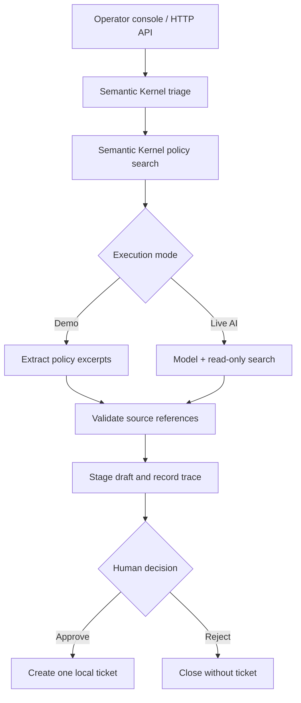

# SupportForge

**A support agent you can run, inspect, test, and ship.**

SupportForge turns a customer question into a policy-backed draft, a triage decision, and a
reviewable local ticket proposal. It combines **Microsoft Semantic Kernel**, **Docker**, and
**GitHub Actions** in one practical Python project.

It is a portfolio and learning application with fictional company policies. It does not send
customer messages or connect to a real helpdesk. The included browser console is served by the API.

## What it does

- Uses real Semantic Kernel `Knowledge.search` and `Triage.classify` plugins.
- Searches Markdown policies with SQLite FTS5/BM25; returns inspectable source excerpts.
- Runs without an API key in **demo mode**, using extractive answers instead of a simulated LLM.
- Supports **live OpenAI mode** through Semantic Kernel with structured outputs and bounded,
  read-only tool calling. A live run sends the question and policy excerpts to the model provider.
- Holds every ticket proposal for human review. Approval creates one **local** ticket.
- Records request/review history, validates citation IDs, rejects conflicting retries, and keeps
  tickets unique even when two reviewers approve concurrently.
- Includes a responsive operator console, OpenAPI documentation, Docker Compose, tests,
  container smoke checks, and a release workflow that publishes an image to GHCR.

## Run with Docker

Install Docker Desktop or Docker Engine with Compose, then run from this directory:

```bash
docker compose up --build -d
```

Open **http://localhost:8000**. API documentation is at **http://localhost:8000/docs**.
Try a sample question, inspect **Sources** and **Execution trace**, enter your reviewer name,
and choose **Approve & create local ticket**. Data persists in the `supportforge-data` volume.

```bash
docker compose logs -f app
docker compose down
```

`docker compose down` retains the database volume. The default port binding is loopback-only.
Use fictional data while exploring the demo.

## Run with Python

Install Python 3.12 and [uv](https://docs.astral.sh/uv/getting-started/installation/).

```bash
uv sync --frozen
uv run uvicorn supportforge.app:create_app --factory --host 127.0.0.1 --port 8000
```

The lockfile records exact resolved dependency versions. Tests also cover Python 3.13 in CI;
the container runtime is Python 3.12.

## Enable a real model

The default is `SUPPORTFORGE_MODE=demo`. To enable live AI:

1. Copy `.env.example` to `.env`.
2. Set `SUPPORTFORGE_MODE=openai` and supply your own `OPENAI_API_KEY`.
3. Choose an OpenAI model supporting chat completions, function calling, and structured outputs
   in `OPENAI_MODEL`. The default is `gpt-4o-mini`; access depends on your provider account.
4. Restart Compose with `docker compose up --build -d`.

For Python, use `uv run uvicorn supportforge.app:create_app --factory --env-file .env`.
Model usage can incur provider charges. Secrets belong in environment variables; `.env` is
excluded from Git and the container build context. Do not put an API key in this repository.

To protect `/api/*`, set `SUPPORTFORGE_API_TOKEN` and enter that token through the console's gear
button. This is a simple shared operator credential, not separate customer accounts or roles.
See [the operating limits](docs/OPERATIONS.md) before exposing an instance beyond your machine.

## How the agent works



The application controls the workflow; the model cannot approve reviews or access write tools.
Live tool invocation is bounded to three auto-invocation attempts and the whole model stage has
a configurable timeout. A citation check verifies source identifiers, not whether every claim
is logically supported. Human review remains necessary.

See [architecture](docs/ARCHITECTURE.md) for plugin boundaries, persistence, and design tradeoffs.

## Test it

```bash
uv run ruff check .
uv run ruff format --check .
uv run pytest
uv run python scripts/evaluate.py
uv run python scripts/check_server.py
uv build
```

Optional console regression tests require Node.js 22 or newer:

```bash
npm ci --ignore-scripts
npm test
```

These use a development-only DOM library and mock HTTP responses. The application itself serves
plain JavaScript without an npm install, bundler, CDN, or frontend runtime dependencies.

The tests run offline and exercise actual Semantic Kernel plugin invocation. Live-provider
responses are replaced at the connector boundary for validation/error tests; those tests do not
establish real provider availability or model quality. Retrieval evaluation uses labelled examples
in `evals/cases.json`. [Testing details and limits](docs/TESTING.md).

With the server running:

```bash
uv run python scripts/smoke.py http://localhost:8000
```

The smoke check creates a labelled demo request and approves a local ticket, so run it against a
demo/test database. If authentication is enabled, export `SUPPORTFORGE_API_TOKEN` first.

## GitHub and CI/CD

Push the project into a GitHub repository with GitHub Actions enabled:

| Workflow | Trigger | What happens |
| --- | --- | --- |
| CI | Push to `main`, pull request, manual run | Frozen dependency install; lint; format; coverage tests; retrieval evaluation; package build; Docker build and HTTP smoke check |
| Release | A `v*` Git tag | Re-runs CI, builds a container, and publishes version + commit tags to GitHub Container Registry |

Publishing a container is continuous delivery. Deploying it to a running server is a separate,
operator-controlled step; no hosting account or deployment target is assumed. GitHub's normal
Actions/package permissions and usage limits apply. No model key is required in CI.

For a release, use a tag matching `pyproject.toml`, e.g. `v0.1.0`. Then pull the image using the
lowercase repository path, such as `ghcr.io/your-account/supportforge:0.1.0`, and follow
[the operations guide](docs/OPERATIONS.md). The workflow does not assert that an image has
already been published.

## Change the knowledge base

Replace the files in `src/supportforge/sample_knowledge/` with approved Markdown policies, or
set `SUPPORTFORGE_KNOWLEDGE_DIR` to a mounted directory. Documents are re-indexed on startup.
The input supports local `.md` files, split by level-two headings and long sections. It does not
scrape websites, accept arbitrary URLs, or fetch customer attachments.

## Project map

| Location | Purpose |
| --- | --- |
| `src/supportforge/agent.py` | Kernel plugins, orchestration, demo/live drafting |
| `src/supportforge/knowledge.py` | Markdown indexing and FTS5 search |
| `src/supportforge/store.py` | SQLite runs, tickets, transactional reviews, audit records |
| `src/supportforge/app.py` | HTTP API, auth option, operator console |
| `src/supportforge/static/` | Dependency-free responsive UI |
| `tests/`, `evals/` | Workflow tests and labelled retrieval cases |
| `.github/workflows/` | CI and container release delivery |

## Primary references

- [Microsoft Semantic Kernel](https://learn.microsoft.com/en-us/semantic-kernel/overview/)
- [Semantic Kernel plugins](https://learn.microsoft.com/en-us/semantic-kernel/concepts/plugins/)
- [SQLite FTS5](https://www.sqlite.org/fts5.html)
- [GitHub Actions](https://docs.github.com/en/actions/get-started/understand-github-actions)
- [Docker build best practices](https://docs.docker.com/build/building/best-practices/)

MIT licensed. All sample customers, requests, and business policies are fictional.
